# 作业 2

区块链原理与技术（CS9301）　第 6 周

## 1. 从发现节点到取得交易

> 节点 A 已持有交易 $t_1$ 的完整内容：甲向乙支付 9，附甲的数字签名，交易标识为 $h_1$。节点 C 已连接 B，但尚未连接 A，也没有 $t_1$。B 保存的候选地址中包含 A 的 IP 地址和端口。
>
> 随后发生以下事件。表中每一步均在前一步完成后发生。
> 
> | 步骤 | 事件 |
> | --- | --- |
> | ① | C 向 B 发送 getaddr，并收到包含 A 地址的 addr 回复。 |
> | ② | C 与 A 建立传输连接，完成 version 和 verack 握手。 |
> | ③ | C 收到 A 发来的 $inv(h_1)$，随后向 A 请求该交易。 |
> | ④ | C 收到 A 发来的 tx 消息，其中包含完整的 $t_1$。 |
> | ⑤ | C 独立检查通过，且满足本地准入条件，将 $t_1$ 暂存入池。 |
>
> 另一节点 D 已与 C 完成握手，但尚无 $t_1$。本题期间没有新区块产生，各节点的已确认记录均未改变。
>
>回答下列问题：

在回答问题之前，将题中描述的步骤和事件用序列图表示：

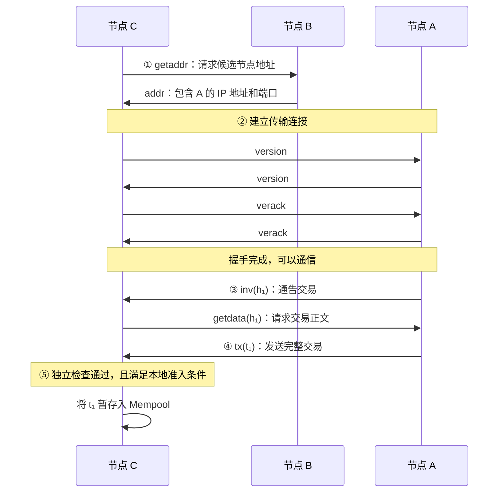

### 1.1 问题（1）

>（1）分别说明步骤①、②使 C 获得了什么。取得地址或完成握手，能否证明 A 提供的交易可信？为什么？

步骤 1 ：节点 C 通过 getaddr 和 addr 消息获得了节点 A 的 IP 地址和端口

步骤 2 ：节点 C 与 A 建立了传输连接，并通过 version 消息交换协议版本、服务能力等信息，通过 verack 消息确认收到对方的版本信息，从而完成 P2P 协议握手

**取得地址或完成握手，不能证明 A 提供的交易可信**； 
原因:
- 因为取得地址和握手仅解决节点定位及通信问题，不保证节点诚实，也不能证明交易有效。
- C 收到交易正文后，仍需独立验证数字签名、发送数据的正确性、以及其他交易有效性条件。

### 1.2 问题（2）

>（2）写出步骤③中 C 应发送的消息名称、方向和目标标识。C 最早在哪一步取得验证签名所需的数据？“可以开始验签”是否等于“验签已通过”？

步骤 3 中 C 应该发送的：
- 消息名称：`getdata`
- 方向：$C \rightarrow A$
- 目标标识：$h_1$

C 最早在步骤 4 中可以取得验证签名所需的数据。

“可以开始验签”并不等于“验签已通过” 
前者仅表示节点已经获得执行签名验证所需的数据；后者则要求实际执行密码学验证并确认签名有效。

### 1.3 问题（3）

>（3）步骤⑤之后，C 如何使 D 取得 $t_1$？写出通告、请求和传输正文三个环节的消息方向及内容，并说明 D 收到正文后还需做什么。

C 在 步骤 5 中，将 $t_1$ 暂存入池，可以选择将其传播给其他节点。通过向 D 发送 $\text{inv}(h_1)$，D 会请求 $\text{getdata}(h_1)$，C 会发送 $\text{tx}(t_1)$，此时 D 就获取了 $t_1$ 的完整内容。

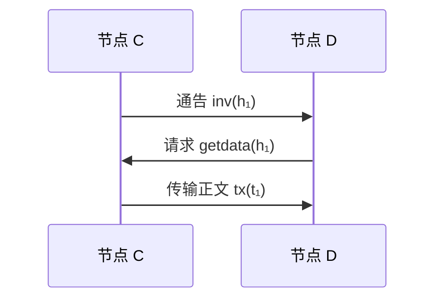

| 环节 | 消息方向 | 消息内容 |
| --- | --- | --- |
| 通告 | $C \rightarrow D$ | $\text{inv}(h_1)$ |
| 请求 | $D \rightarrow C$ | $\text{getdata}(h_1)$ |
| 传输正文 | $C \rightarrow D$ | $\text{tx}(t_1)$ |

D 在收到正文后，需要：
- 计算交易标识是否与请求标识 $h_1$ 一致
- 验证数字签名是否有效
- 验证交易有效性规则
- 检查是否满足本地池准入条件

### 1.4 问题（4）

>（4）若 C 又收到其他邻居对 $h_1$ 的通告，是否需要重复获取同一正文？若 A、C、D 的交易池均已有 $t_1$，能否据此认定乙已收到确认付款？分别说明依据。

**不需要重复获取同一正文**。 
理由： 
此时 C 已经接收到了 $t_1$ 的完整内容，如果 C 又收到其他邻居对 $h_1$ 的通告，可以根据交易标识 $h_1$ 查询本地已保存的交易，判断自己已经拥有 $t_1$，因此无须再次发送 $\text{getdata}(h_1)$ 请求交易正文。

**不能据此认定 乙 已经收到确认付款**。 
理由： 
多个节点的本地池中均有同一交易 $t$，这只能说明 $t$ 被这些节点接受(accepted)了，但并不能已经通过共识机制将交易 $t$ 确认(confirmed)了。 
交易池中的交易仍属于未确认交易。只有交易被包含在有效区块中，并按照相应共识协议获得确认后，才能认为其获得链上确认。 
题目中有说："[本题期间没有新区块产生，各节点的已确认记录均未改变。](#confirmed_state_no_change)"，这说明没有通过共识产生新的区块，因此这些交易都没有获得链上确认，因此不能认定乙已收到经过确认的付款。

## 2. 相同交易为何得到不同的入池结果

>节点 P、Q 的已确认记录相同，采用相同的交易有效性规则和以下本地交易池策略：
>
>- 交易池最多暂存 3 笔不同的交易；已满时不替换原有交易。
>- 对新交易先检查有效性；检查通过且池中有空位时才接纳。
>- 同一交易按标识只保存一份；重复到达不占用新空位。
>- 本题期间不移出交易，没有新区块，也没有表外事件。
>
>初始交易池如下，池中已有交易均已通过检查。
>
>| 节点 | 初始交易池 |
>| --- | --- |
>| P | $M_P = \{t_1\}$ |
>| Q | $M_Q = \{t_1, t_3, t_4\}$ |
>
>以下三个事件依次发生，每次两节点均收到相同的完整交易并完成处理。新交易与已有交易之间没有输入或余额冲突。
>
>| 事件 | 到达的内容与检查条件 |
>| --- | --- |
>| ① | 完整的 $t_2$ 到达；在两节点均通过所有交易有效性检查。 |
>| ② | 完整的 $t_5$ 到达；两节点均发现付款人的签名验证失败。 |
>| ③ | 与事件①完全相同的 $t_2$ 再次到达。 |
>
>回答下列问题：

在回答问题之前，将题目中描述的处理新交易的流程表示出来：

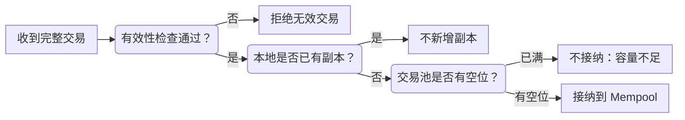

### 2.1 问题（1）

>（1）按事件①、②、③逐步列出 P、Q 的处理结果及处理后的交易池。说明每次未接纳或未新增副本的原因。

**事件 1：完整的 $t_2$ 到达；在两节点均通过所有交易有效性检查。**

考虑节点 P：
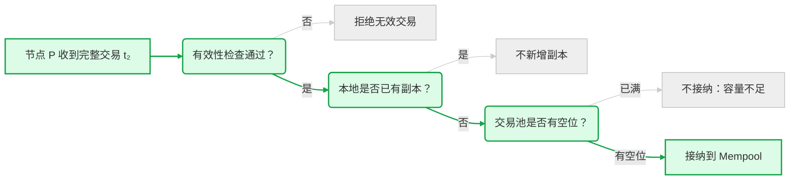

考虑节点 Q：
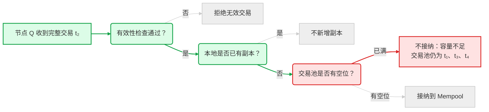

经过事件 1 处理后，节点 P 和节点 Q 的交易池状态为：
| 节点 | 交易池 | 原因 |
| --- | --- | --- |
| P | $M_P = \{t_1, t_2\}$ | 满足条件，纳入本地交易池 |
| Q | $M_Q = \{t_1, t_3, t_4\}$ | 交易池已满，不接纳 $t_2$ |

**事件 2：完整的 $t_5$ 到达；两节点均发现付款人的签名验证失败。**

考虑节点 P：

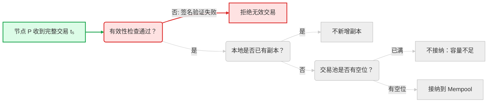

考虑节点 Q：

经过事件 2 处理后，节点 P 和节点 Q 的交易池状态为：
| 节点 | 交易池 | 原因 |
| --- | --- | --- |
| P | $M_P = \{t_1, t_2\}$ | 付款人签名验证失败，有效性检查不通过，不接纳 $t_5$ |
| Q | $M_Q = \{t_1, t_3, t_4\}$ | 付款人签名验证失败，有效性检查不通过，不接纳 $t_5$ |

**事件3：与事件①完全相同的 $t_2$ 再次到达。**

考虑节点 P：

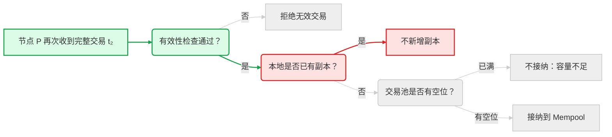

考虑节点 Q：

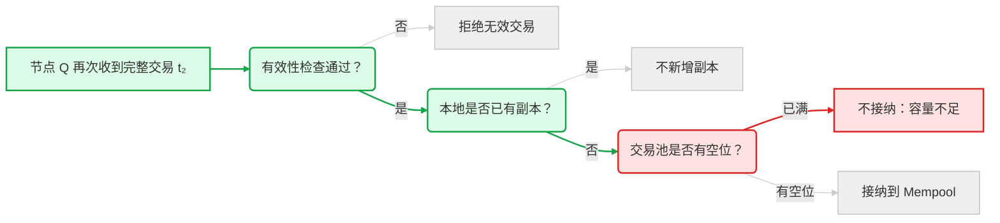

经过事件 3 处理后，节点 P 和节点 Q 的交易池状态为：

| 节点 | 交易池 | 原因 |
| --- | --- | --- |
| P | $M_P = \{t_1, t_2\}$ | 已有 $t_2$，本次忽略重复副本；原副本保留，不占用新空位 |
| Q | $M_Q = \{t_1, t_3, t_4\}$ | 交易池已满，不接纳 $t_2$ |

### 2.2 问题（2）

>（2）比较事件①中 Q 未接纳 $t_2$ 与事件②中 P 未接纳 $t_5$ 的原因。它们是否都能作为“交易有效性检查失败”的证据？

不能。

事件 1 中 Q 不接纳 $t_2$，是因为本地交易池已满，按照规则“已满时不替换原有交易”，因此 Q 不接纳 $t_2$，但这并不说明 $t_2$ 有效性检查失败。实际上，$t_2$ 有效性检查通过。

事件 2 中 P 不接纳 $t_5$，是因为付款人签名验证失败，有效性检查不通过，不接纳 $t_5$。这是交易有效性检查失败的证据。

### 2.3 问题（3）

>（3）假设只观察到另一节点 R 的交易池没有 $t_2$，没有其他信息。列出三种可能原因，并说明至少还应查看哪些本地记录才能区分。

1. P2P 网络接收：
    - 原因：节点 R 可能尚未收到其他节点对 $t_2$ 的通告，或者虽然收到了通告，但尚未获取完整交易正文。
    - 后续检查：需要查看 P2P 消息收发记录，确认是否收到交易通告、是否发送数据请求及是否接收到完整交易。
2. 交易有效性检查失败：
    - 原因：R 可能已经收到完整的 $t_2$，但在本地有效性检查过程中未能通过，因此 R 不接纳 $t_2$。
    - 后续检查：需要查看 R 的交易有效性检查记录，确认是否进行过对 $t_2$ 的有效性检查。
3. 交易池已满：
    - 原因：节点 R 交易池有可能已满，不接纳 $t_2$。
    - 后续检查：需要查看交易池准入日志及交易到达时的容量状态，确认是否存在容量不足的情况。

### 2.4 问题（4）

>（4）P、Q 的交易池不同，是否足以认定两节点的已确认账本发生分歧？若 P 已接纳 $t_2$，是否意味着它已完成该笔付款的确认？

**P，Q 交易池不同，并不能认定两节点的已确认账本发生分歧。**

这里需要区分 本地接纳 (accepted) 和 确认 (confirmed) 的区别。

本地接纳 (accepted) 是指节点在本地交易池中接纳交易，而确认 (confirmed) 是指经过区块链确认的交易历史及其状态。 
而已确认账本发生分歧，是指在不同节点上，已确认的交易历史和状态不同。由于题目中明确提到了：“[节点 P、Q 的已确认记录相同](#same_confirmed_history)”，且 “[没有新区块](#no_new_block)”产生，所以两个节点的已确认账本并没有发生变化。

**P 已接纳 $t_2$，并不意味着它已完成该笔付款的确认。**

P 接纳 $t_2$ 仅说明交易通过了本地交易池准入条件。 
但该交易仍处于待确认状态，需要后续被纳入有效区块中，并按照相应的共识协议获得确认，才能认为该付款获得链上确认。

## 3. 区块乱序到达时如何推进验证

>节点 N 已完整验证并处理到区块 $B_{200}$，相应状态保存完好。它已取得并检查下列候选区块头，确认前序链接连续；但尚未取得这三个区块的正文。记 $h_i = H(B_i)$ 为区块 $B_i$ 的哈希。
>
>| 区块 | 本块哈希 | 前序区块哈希 |
>| --- | --- | --- |
>| $B_{201}$ | $h_{201}$ | $h_{200}$ |
>| $B_{202}$ | $h_{202}$ | $h_{201}$ |
>| $B_{203}$ | $h_{203}$ | $h_{202}$ |
>
> N 从不同邻居并行下载，按下表顺序收到回复。正确副本的格式、正文摘要及交易规则均满足要求；第③次回复是例外。
>
>| 次序 | 收到的回复 |
>| --- | --- |
>| ① | R 返回正确的 $B_{203}$。 |
>| ② | Q 返回正确的 $B_{202}$。 |
>| ③ | P 返回声称为 $B_{201}$ 的数据，但正文与已持有头部的摘要不匹配。 |
>| ④ | N 另向 Q 请求后，收到正确的 $B_{201}$。 |
>
>处理约定：每次收到数据，先核对目标、格式和正文摘要；通过后暂存，再尽可能按前序依赖完成验证并应用交易。已验证区块移出待处理区，但保留本地存档；不合格副本不进入待处理区。本题不涉及候选链切换。
>
>回答下列问题：

在回答问题之前，将题中描述的对应事件用序列图表示：
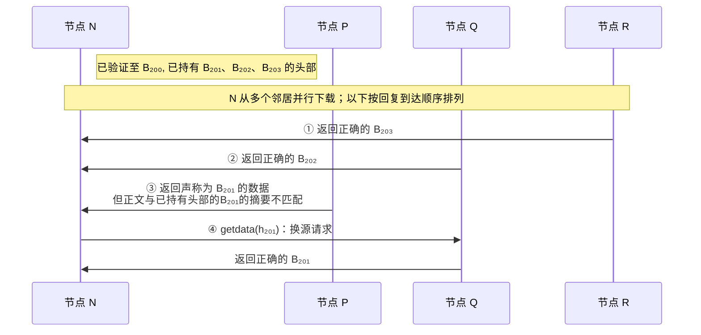

### 3.1 问题（1）

>（1）仅取得并检查三个区块头后，N 能否将本地已验证进度记为 $B_{203}$？说明区块头已提供的信息，以及 N 还缺少的数据和检查。

不能，仅仅取得并检查三个区块头后，N 不能将本地已验证进度记为 $B_{203}$。

区块头提供了：
- 前序区块的哈希值
- 区块内交易的摘要值

通过检查区块头，N 可以确认三个候选区块的前序哈希链接连续，但无法据此判断完整区块正文及其中的交易是否有效。

N 还需要取得三个区块的完整正文，然后做以下的检查
- 检查正文格式及摘要是否与对应区块头匹配，并验证区块内的交易是否满足协议规则。
- 按照 $B_{201} \rightarrow B_{202} \rightarrow B_{203}$ 的顺序，依次完成区块验证，执行交易，更新状态。

完成上述的操作后，N 才可以将本地的已验证进度记为 $B_{203}$。

### 3.2 问题（2）

>（2）对第①至④次回复分别列出：拒绝或暂存的内容、本轮完成验证的区块顺序、处理后的待处理区、最新已验证位置。

| 事件 | 拒绝或暂存的内容 | 本轮完成验证的区块顺序 | 处理后的待处理区 | 最新已验证位置 |
| --- | --- | --- | --- | --- |
| 0. 初始 | - | - | $\{ \}$ | $B_{200}$ |
| 1. R 返回正确的 $B_{203}$ | 暂存 $B_{203}$ | - | $\{B_{203}\}$ | $B_{200}$ |
| 2. Q 返回正确的 $B_{202}$ | 暂存 $B_{202}$ | - | $\{B_{202}, B_{203}\}$ | $B_{200}$ |
| 3. P 返回声称为 $B_{201}$ 的数据，但正文与已持有头部的摘要不匹配 | 拒绝 $B_{201}$ | - | $\{B_{202}, B_{203}\}$ | $B_{200}$ |
| 4. N 另向 Q 请求后，收到正确的 $B_{201}$ | 暂存 $B_{201}$ | $B_{201} \rightarrow B_{202} \rightarrow B_{203}$ | $\{ \}$ | $B_{203}$ |

### 3.3 问题（3）

>（3）收到第③次回复后，N 应向其他邻居用什么消息和标识请求缺失数据？是否需要重新下载已保存的 $B_{202}$、$B_{203}$？能否据此判定 $h_{201}$ 对应的正确区块无效？

收到第3次回复后，N 应该向其他邻居（例如题目中的 Q）使用 $\text{getdata}(h_{201})$ 请求缺失数据。

不需要重新下载已保存的 $B_{202}$、$B_{203}$，因为这两个区块的正文已经接受，并通过了验证，暂存在待处理区中了。

也不能据此判定 $h_{201}$ 对应的正确区块无效。因为这次收到的 $B_{201}$ 是声称为 $B_{201}$ 的数据，是不合格副本，该副本与 $h_{201}$ 对应的区块头不匹配。

### 3.4 问题（4）

>（4）有同学认为“TCP 保证有序传输，所以 $B_{203}$ 不可能先到”。结合本题的多邻居连接说明这一判断的问题，并区分接收顺序与验证顺序。

这种判断是错误的。

TCP 保证有序传输，这个结论限定在单次连接中。 TCP 保证的是同一条连接中字节流的有序传输，并不保证不同连接之间的数据到达顺序。

而在多邻居连接中，由于每个连接的传输是独立的，且具体通信情况不同，所以会出现乱序到达的情况。结合本题，节点 N 从 R、Q、P 等多个邻居并行下载区块，各连接相互独立，受到网络延迟，传输速度，拓扑连接等因素影响，因此 $B_{203}$ 完全可能先于 $B_{202}$、$B_{201}$ 到达。

**接收顺序**和**验证顺序**不一定相同。 
**接收顺序**是指区块数据实际到达节点的先后顺序，接收顺序由 P2P 网络中具体的通信情况决定。前序的区块可能会因为延迟，传输速度，拓扑等因素，导致到达时间不同。 
**验证顺序**是按照前序依赖完成验证，执行交易的顺序，这个顺序是固定的。

## 4. 超时换源后怎样处理迟到回复

>节点 N 已持有区块 $B_{301}$ 的候选头部，目标是取得对应的完整区块，目标哈希为 $h_{301}$。N 与 P、Q 已完成握手，最初没有该区块正文。
>
>本次下载使用以下规则：每次请求等待 4 秒；先请求 P，到期仍未完成则改向 Q，最多发出两次请求。只有目标匹配，且格式与正文摘要检查通过，才保存一份并标记下载完成。完成后不重复保存；旧超时事件触发时先检查任务状态。检查耗时忽略不计。
>
>事件按时间先后如下，所有时刻均以秒为单位。
>
>| 时刻 | 事件 |
>| --- | --- |
>| $t = 0$ | N 向 P 发送 $getdata(h_{301})$。 |
>| $t = 4$ | 尚未收到目标正文，N 改向 Q 发送 $getdata(h_{301})$。 |
>| $t = 5$ | P 返回完整的 $B_{302}$，其哈希为 $h_{302}$，与目标不同。 |
>| $t = 6$ | Q 返回目标 $B_{301}$；格式与正文摘要检查均通过。 |
>| $t = 7$ | P 又返回与 Q 所提供内容完全相同的 $B_{301}$。 |
>| $t = 8$ | 为 Q 设置的旧超时事件触发。 |
>
>回答下列问题：

在回答问题之前，将题中描述的时刻和对应事件用序列图表示：

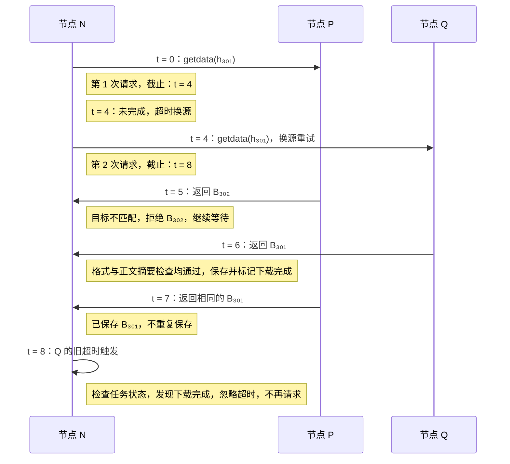

### 4.1 问题（1）

>（1）分别写出 $t = 0$、$t = 4$ 时 N 的请求记录，包括目标标识、最新请求来源、累计尝试次数和等待截止时刻。仅凭第一次超时，能否认定 P 恶意或目标区块无效？

| 时刻 | 目标标识 | 最新请求来源 | 累计尝试次数 | 等待截止时刻 |
| --- | --- | --- | --- | --- |
| $t = 0$ | $h_{301}$ | $P$ | 1 | $t = 4$ |
| $t = 4$ | $h_{301}$ | $Q$ | 2 | $t = 8$ |

仅凭第一次超时，不能认定 P 是恶意节点，也不能认定目标区块 $B_{301}$ 无效。

因为超时只说明 N 在规定的等待时间内未收到目标区块的完整回复，可能是由于网络延迟、消息丢失、节点处理速度较慢或暂时不可用等原因造成的。

### 4.2 问题（2）

>（2）逐一说明 $t = 5$、$t = 6$、$t = 7$、$t = 8$ 时 N 应采取的动作、任务是否完成，以及已保存的目标区块副本数。不要把非目标区块计入副本数。

上面的流程图已经展示了 $t = 5$、$t = 6$、$t = 7$、$t = 8$ 时 N 的动作。

| 时刻 | N 应采取的动作 | 任务是否完成 | 已保存的目标区块副本数 |
| --- | --- | --- | --- |
| $t = 5$ | P 返回的 $B_{302}$ 与目标哈希 $h_{301}$ 不匹配，拒绝 $B_{302}$，继续等待 | 否 | 0 |
| $t = 6$ | Q 返回的 $B_{301}$ 与目标匹配，且格式与正文摘要检查均通过，保存并完成，标记下载完成 | 是 | 1 |
| $t = 7$ | 已保存 $B_{301}$，不重复保存 | 是 | 1 |
| $t = 8$ | 检查任务状态，发现下载完成，忽略超时，不再请求 | 是 | 1 |

### 4.3 问题（3）

>（3）只修改一个条件：$t = 5$ 时 P 返回的是检查通过的 $B_{301}$，其余事件不变。N 能否采用 P 的回复提前完成下载？说明此后 $t = 6$、$t = 7$、$t = 8$ 的处理结果。

可以采用 P 的回复提前完成下载。

此时时序图会变为：

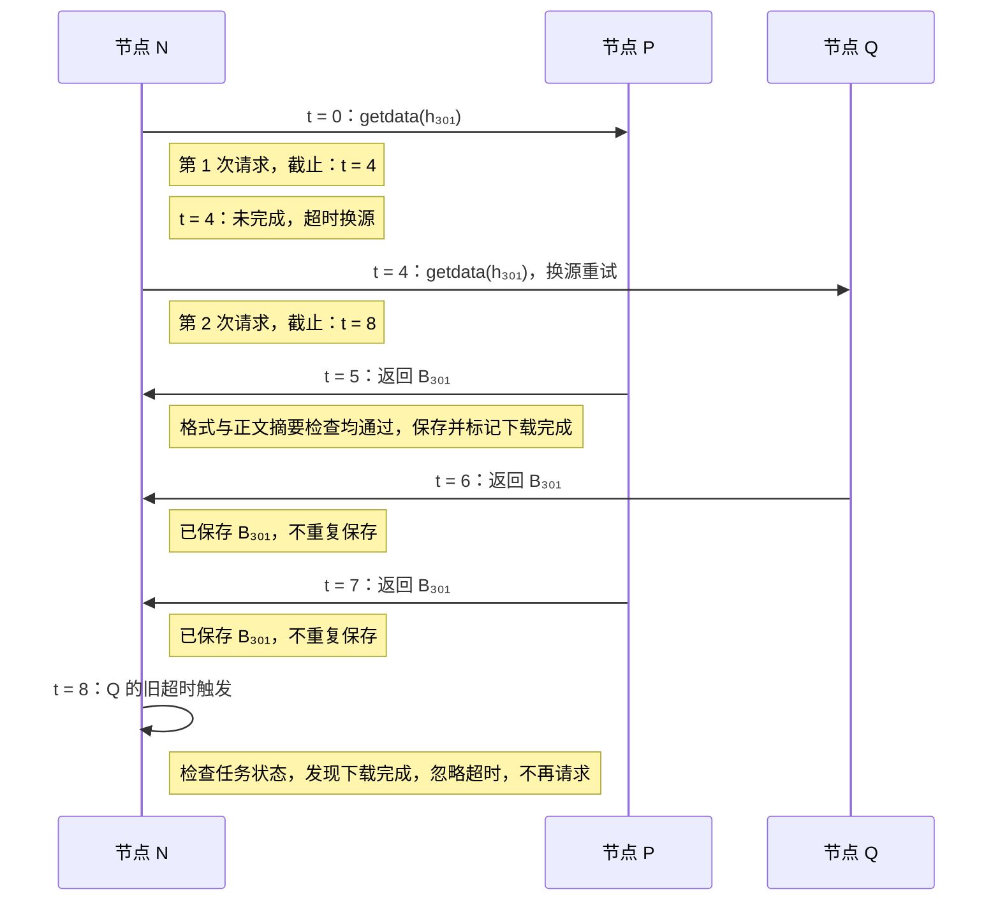

| 时刻 | N 应采取的动作 | 任务是否完成 | 已保存的目标区块副本数 |
| --- | --- | --- | --- |
| $t = 5$ | P 返回的 $B_{301}$，与目标匹配，且格式与正文摘要检查均通过，保存并标记下载完成 | 是 | 1 |
| $t = 6$ | 已保存 $B_{301}$，不重复保存 | 是 | 1 |
| $t = 7$ | 已保存 $B_{301}$，不重复保存 | 是 | 1 |
| $t = 8$ | 检查任务状态，发现下载完成，忽略超时，不再请求 | 是 | 1 |

### 4.4 问题（4）

>（4）回到原情境。若下载完成时 N 还没有处理完前序区块 $B_{300}$，能否立即应用 $B_{301}$ 中的交易？说明下载完成与完整验证完成的区别。

不能立即应用 $B_{301}$ 中的交易。 
**理由：**
因为 $B_{301}$ 的验证和状态更新依赖于前序区块 $B_{300}$ 执行完成后的状态。 
如果 N 尚未处理完 $B_{300}$，就无法获得验证和执行 $B_{301}$ 所需的正确前序状态。 
因此，N 应先保存 $B_{301}$，等待 $B_{300}$ 完成验证与状态更新后，再继续处理 $B_{301}$。

说明**下载完成**和**完整验证完成**的区别：
- **下载完成**是指接收到了完整的正文，通过了目标匹配，格式与正文摘要检查，将对应的区块下载保存到了本地。
- **完整验证完成**是指在下载完成的基础上，进一步检查区块及其交易是否满足协议规则，按照前序依赖关系执行交易，并完成相应的状态更新。
