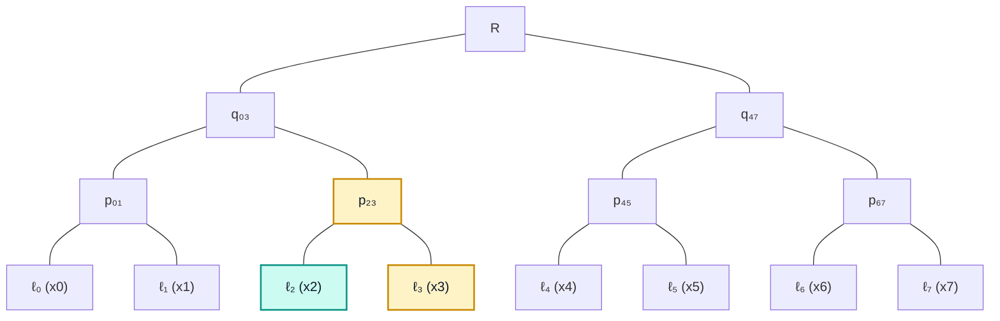
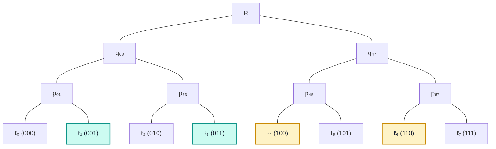

# 第8周作业

区块链原理与技术（CS9301） 第 8 周

## 1. 同一组输出怎样形成依赖与冲突

>初始 UTXO 集合为 $U_{0} = \{ u_{0},u_{1},z\}$，金额单位均为 sat。旧交易 F 的两个输出均由 A 控制；z 由 D 控制，与本题交易无关。
>
>| **输出标识**            | **金额** | **花费条件** |
>|-------------------------|----------|--------------|
>| $u_{0} = (txid(F),0)$ | 6        | 由 A 授权    |
>| $u_{1} = (txid(F),1)$ | 6        | 由 A 授权    |
>| $z$                   | 4        | 由 D 授权    |
>
>有以下三笔普通非 coinbase 交易。所有输入授权正确，采用 SIGHASH_ALL；格式、金额范围及其他条件均满足要求。新输出标识互不冲突，冒号后为从 0 开始的输出序号。
>
>| **交易** | **引用的输入**    | **创建的新输出**                 |
>|----------|-------------------|----------------------------------|
>| T        | $u_{0},\ u_{1}$ | T:0 向 B 支付 9；T:1 向 A 找零 2 |
>| V        | T:1               | V:0 向 C 支付 2                  |
>| X        | $u_{1}$         | X:0 向 E 支付 5                  |
>
>节点按① V、② T、③ X、④ V 的顺序逐次检查；每次检查通过才完整更新 UTXO 集合，否则保留原状态。除第④步明确重试 V 外，不自动重试，也没有其他交易。
>
>回答下列问题：

### 1.1 问题（1）
>（1）为什么 $u_{0}$ 与 $u_{1}$ 不能因金额和控制者相同而视为一个输出？计算 T 的输入总额、输出总额和手续费，并说明手续费是否是 T 的第三个普通输出。

因为 UTXO 模型中，一笔交易可以创建多个输出，每个输出的身份标识由 $(\text{txid}, \text{outputIndex})$ 确定，不能只根据输出的金额和控制者来判断是否为同一个输出。

输入总额：$\sum \text{Input} = \sum_{i=0}^{1} u_{i} = 6+6 = 12$  
输出总额：$\sum \text{Output} = \sum_{i=0}^{1} {T:i} = 9+2 = 11$  
手续费：$\text{Fee} = \sum \text{Input} - \sum \text{Output} = 12 - 11 = 1$  

手续费并不是 T 的第三个普通输出

### 1.2 问题（2）
>（2）依次列出①至④的检查结果、拒绝原因及处理后的 UTXO 集合。为什么 V 在①与④的结果可以不同？

初始 UTXO 交易集合为：$U_{0} = \{ u_{0},u_{1},z\}$

(1) 检查 $V$ 交易 
节点收到 $V$，需要引用 $T:1$，但是现在集合中没有 $T:1$，所以 $V$ 交易被拒绝。 
处理后的 UTXO 集合为：$U_{1} = U_{0} = \{ u_{0},u_{1},z\}$

(2) 检查 $T$ 交易 
节点收到 $T$，需要引用 $u_{0}$ 和 $u_{1}$，此时集合中有 $u_{0}$ 和 $u_{1}$，因此检查通过。 
处理后的 UTXO 集合为：$U_{2} = (U_{1} - \{ u_{0},u_{1}\}) \cup \{ T:0,T:1\} = \{ z, T:0,T:1\}$

(3) 检查 $X$ 交易 
节点收到 $X$，需要引用 $u_{1}$，此时集合中没有 $u_{1}$，所以 $X$ 交易被拒绝。 
处理后的 UTXO 集合为：$U_{3} = U_{2} = \{ z, T:0,T:1\}$

(4) 检查 $V$ 交易 
节点再次收到 $V$，需要引用 $T:1$，此时集合中有 $T:1$，因此检查通过。 
处理后的 UTXO 集合为：$U_{4} = (U_{3} - \{ T:1\}) \cup \{ V:0\} = \{ z, T:0, V:0\}$

$V$ 在第（1）步和第（4）步的检查结果不同，是因为两次检查时的 UTXO 状态不同。 
第（1）步时，交易 $T$ 尚未被应用，UTXO 集合中不存在 $V$ 所引用的 $T:1$，因此 $V$ 被拒绝。 
第（2）步应用 $T$ 后，$T:1$ 被创建并加入 UTXO 集合，因此第（4）步重新检查 $V$ 时，其输入已经可用，$V$ 可以通过检查。

### 1.3 问题（3）
>（3）分别判断 T 与 V、T 与 X 是前后依赖还是双花冲突，指出涉及的具体输出。T 与 X 的签名均正确，是否就能在同一段有效历史中都被应用？

前后依赖：一笔交易引用了另一笔交易创建的输出，导致这两笔交易形成前后依赖关系。 
双花冲突：两笔交易引用了同一个 UTXO 输出，导致这两笔交易形成双花冲突。

因此，可以判断： 
$T$ 与 $V$ 是前后依赖关系，因为 $T$ 创建了 $T:1$ 输出，而 $V$ 引用了 $T:1$ 输出。 
$T$ 与 $X$ 是双花冲突，因为 $T$ 引用了 $u_{1}$ 输出，而 $X$ 也引用了 $u_{1}$ 输出。 

$T$ 与 $X$ 的签名均正确，但并不能在同一段有效历史中都被应用，因为一旦有一方花费了共同引用的 UTXO $u_{1}$ 输出，就会导致 UTXO 集合中没有 $u_{1}$，因此另一方无法应用。

### 1.4 问题（4）
>（4）独立回到初始状态：若 T 对 $u_{1}$ 的授权失败，能否先删除已通过授权检查的 $u_{0}$？若改动 T:0 的收款条件为 M 并沿用原签名，能否通过验签？分别说明理由。

因为交易具有原子性，因此当交易包含多个输入时，验证授权可以逐项进行，但状态必须遵循整体成功或整体失败的原则。 
因此，若 $T$ 对 $u_{1}$ 的授权失败，因此 $T$ 交易被拒绝，不能先删除已通过授权检查的 $u_{0}$。

如果改动 $T:0$ 的收款条件为 $M$ 并沿用原签名，无法通过验签。 
因为这里规定交易使用 `SIGHASH_ALL`，改动 $T:0$ 的收款条件会改变签名对应的交易摘要，因此原签名不再有效。 

## 2. 前置检查与执行回滚怎样影响账户

>A 初始余额为 0.5 ETH，发送 nonce 为 4；B 初始余额和 nonce 均为 0。A 为未委托的普通 EOA，B 无代码。下列均为同一条链上的 type-2 交易，签名与格式正确，不含代码委托等扩展。
>
>各次尝试的基础费均为 20 gwei/gas，小费上限为 3 gwei/gas，总单价上限 maxFee 为 40 gwei/gas。$1\ gwei = 10^{- 9}\ ETH$。U 调用售票合约 K，进入执行后触发顶层 REVERT；票款转移及本次应用效果均回滚。
>
>| 交易 | 动作及 nonce | gasLimit | 进入执行时的结果 |
>|:---:|---|---:|---|
>| T | A 向 B 转 0.12 ETH；nonce = 4 | 21 000 | 成功；实际用量 21 000 |
>| U | A 向 K 付 0.08 ETH 购票；nonce = 5 | 50 000 | REVERT；实际用量 30 000 |
>| V | A 向 B 转 0.05 ETH；nonce = 5 | 21 000 | 若能执行，则成功；用量 21 000 |
>
>处理顺序为①尝试 U、②尝试 T、③重新尝试 U、④尝试 V。每步依据当前状态重新检查，只有前置检查通过才进入链上执行并结算；前置检查未通过不扣链上 gas、不推进 nonce。没有表外交易，A 不获得其他入账。
>
>回答下列问题：

### 2.1 问题（1）
>（1）第①步能否进入执行？说明失败原因，以及是否意味着 U 永远无法执行。第②步中，计算 T 所需的费用上限支付能力、有效 gas 单价和实际手续费。

第一步不能执行。 
因为当前 $\text{nonce}(A) = 4$，因此目前能执行的下一步交易的 nonce 值应该为 4。 
而 $U$ 的 nonce 值为 5，因此 $U$ 交易不能进入执行。 

但这并不意味着 $U$ 交易永远无法执行。 
因为 $U$ 交易的 nonce 值为 5，而 $T$ 交易的 nonce 值为 4，所以 $U$ 交易可以在 $T$ 交易后进入执行。 

前置余额检查需要检查 $T$ 所需的费用上限支付能力。 
$$
\begin{aligned}
\text{requiredBalance} &= \text{Value} + \text{gasLimit} \times \text{maxFee} \\
&= 0.12 \text{ ETH} + 21000 \times 40 \text{ gwei} \\
&= 0.12 \text{ ETH} + 21000 \times 40 \times 10^{-9} \text{ ETH} \\
&= 0.12 \text{ ETH} + 0.00084 \text{ ETH} \\
&= 0.12084 \text{ ETH}
\end{aligned}
$$

有效 gas 单价为： 
$$
\begin{aligned}
\text{effectiveGasPrice} &= \min(\text{maxFee}, \text{baseFee} + \text{maxPriorityFee}) \\
&= \min(40 \text{ gwei/gas}, 20 \text{ gwei/gas} + 3 \text{ gwei/gas}) \\
&= 23 \text{ gwei/gas}
\end{aligned}
$$

实际手续费： 
$$
\begin{aligned}
\text{gasFee} &= \text{gasUsed} \times \text{effectiveGasPrice} \\
&= 21000 \text{gas} \times 23 \text{ gwei/gas} \\
&= 483000 \text{ gwei} \\
&= 4.83 \times 10^{-4} \text{ ETH}
\end{aligned}
$$

### 2.2 问题（2）
>（2）分别写出第②、③步完成后 A、B 的余额与 nonce。第③步还需核对哪些前置条件？计算 U 的实际手续费，并说明 0.08 ETH 票款、已耗 gas 和发送 nonce 各如何处理。

第(2)步前：A 余额为 0.5 ETH，B 余额为 0 ETH 
第(2)步交易是 A 向 B 转 0.12 ETH。 
A 的余额：$\text{balance}(A) = 0.5 - 0.12 - 4.83 \times 10^{-4} = 0.379517 ETH$ 
B 的余额：$\text{balance}(B) = 0 + 0.12 = 0.12 ETH$ 
A 的 nonce 值：$\text{nonce}(A) = 4 + 1 = 5$ 
B 的 nonce 值：$\text{nonce}(B) = 0$ 

第(3)步前：A 余额为 0.379517 ETH 
第(3)步交易是 A 向 K 付 0.08 ETH 购票。 

前置条件检查： 
(1) Nonce 检查：$\text{nonce}(A) = 5$，$U$ 的 nonce 值为 5 。因此满足 nonce 检查。 
(2) 费用上限支付能力检查： 
$$
\begin{aligned}
\text{requiredBalance} &= \text{Value} + \text{gasLimit} \times \text{maxFee} \\
&= 0.08 \text{ ETH} + 50000 \times 40 \text{ gwei} \\
&= 0.08 \text{ ETH} + 50000 \times 40 \times 10^{-9} \text{ ETH} \\
&= 0.08 \text{ ETH} + 0.002 \text{ ETH} \\
&= 0.082 \text{ ETH}
\end{aligned}
$$
目前 A 余额为 0.379517 ETH，大于 $0.082$ ETH，因此通过费用上限支付能力检查。 

计算 $U$ 的实际手续费：
$$
\begin{aligned}
\text{gasFee} &= \text{gasUsed} \times \text{effectiveGasPrice} \\
&= 30000 \text{gas} \times 23 \text{ gwei/gas} \\
&= 690000 \text{ gwei} \\
&= 6.9 \times 10^{-4} \text{ ETH}
\end{aligned}
$$

由于触发了 `REVERT`
- 支付的 0.08 ETH 会被撤销
- 已经消耗的 gas 费用仍然需要支付
- 发送 nonce 5 仍然会增加到 6

因此第(3)步完成后： 
A 的余额：$\text{balance}(A) = 0.379517 - 6.9 \times 10^{-4} = 0.378827 \text{ ETH}$ 
A 的 nonce 值：$\text{nonce}(A) = 5 + 1 = 6$ 
B 的余额和 nonce 值保持不变。 

### 2.3 问题（3）
>（3）第④步 V 能否进入执行？有同学认为“U 执行失败，所以 nonce 5 没有被使用”。这一判断是否正确？结合第①步与第③步说明两种失败的区别。

第(4)步前：A 余额为 0.378827 ETH，A 的 nonce 值为 6 
而第(4)步交易是$V$：A 向 B 转 0.05 ETH，nonce = 5 
由于 nonce 值不等，因此不能通过 nonce 检查。 

该同学的判断不正确。第(3)步 $U$ 已经通过前置检查并进入链上执行。虽然执行过程中触发 `REVERT`，但发送账户 A 的 nonce 仍然从 5 增加到 6，因此 nonce 5 已经被使用。

第(1)步的失败，是没用通过前置检查 
第(3)步的失败，是通过了所有前置检查，但是触发了 `REVERT`，因此 gas 费用仍然需要支付，nonce 仍然会增加。

### 2.4 问题（4）
>（4）独立回到初始状态，只将 A 的余额改为 0.1205 ETH，并首先尝试 T。即使余额够支付转账额与预计实际手续费，T 是否仍能通过费用上限支付能力检查？列式说明。

费用上限支付能力已在 [2.1 问题（1）](#21-问题1) 中计算过：
前置余额检查需要检查 $T$ 所需的费用上限支付能力。 
$$
\begin{aligned}
\text{requiredBalance} &= \text{Value} + \text{gasLimit} \times \text{maxFee} \\
&= 0.12 \text{ ETH} + 21000 \times 40 \text{ gwei} \\
&= 0.12 \text{ ETH} + 21000 \times 40 \times 10^{-9} \text{ ETH} \\
&= 0.12 \text{ ETH} + 0.00084 \text{ ETH} \\
&= 0.12084 \text{ ETH}
\end{aligned}
$$

所以有：$\text{balance}(A) = 0.1205 < 0.12084 = \text{requiredBalance}$，因此 $T$ 不能通过费用上限支付能力检查。

## 3. 包含证明怎样绑定记录与位置

>固定有序列表 $(x_{0},\ldots,x_{7})$ 的八条记录互不相同。采用八叶满二叉 Merkle 树，相邻两叶逐层合并。H 为 SHA256，摘要长 32 字节；叶与内部节点分别定义为：
>
>$\mathcal{l}_{i} = H(00 \parallel enc(x_{i}))$，$I(a,b) = H(01 \parallel a \parallel b)$。
>
>00、01 各为一个字节；enc(x) 为 4 字节大端长度后接 x 的 UTF-8 字节。内部节点先拼左摘要，再拼右摘要。假设不发生哈希碰撞，也不存在不同树节点的摘要恰好相同。
>
>四个相邻叶对的父节点依次为 $p_{01},p_{23},p_{45},p_{67}$；左、右半树根分别为：
>
>$q_{03} = I(p_{01},p_{23})$，$q_{47} = I(p_{45},p_{67})$。
>
>整树根为 $R = I(q_{03},q_{47})$。查询者已独立接受 R，目标是核对位置 2 的记录。
>
>| **回复** | **记录**         | **声称的位置** | **兄弟摘要序列 从叶到根**           |
>|----------|------------------|----------------|-------------------------------------|
>| 甲       | $x_{2}$        | 2              | $(\mathcal{l}_{3},p_{01},q_{47})$ |
>| 乙       | $x_{2}$        | 3              | $(\mathcal{l}_{3},p_{01},q_{47})$ |
>| 丙       | $y \neq x_{2}$ | 2              | $(\mathcal{l}_{3},p_{01},q_{47})$ |
>
>回答下列问题：

### 3.1 问题（1）
>（1）对回复甲，从 $v_{0} = H(00 \parallel enc(x_{2}))$ 开始，依次写出三次合并表达式与最后的比较条件，注明每层兄弟摘要位于左侧还是右侧。是否需要下载其他七条记录的原文？

$v_1 = I(v_0, l_3)$，此层兄弟摘要位于右侧 
$v_2 = I(p_{01}, v_1)$，此层兄弟摘要位于左侧 
$v_3 = I(v_2, q_{47})$，此层兄弟摘要位于右侧 

比较条件：$v_3 == R$

不需要下载其他七条记录的原文。

### 3.2 问题（2）
>（2）回复乙和丙能否证明目标位置 2 的内容？分别指出位置检查或重算根时的问题。若只检查“证明中有三个摘要”，是否足够？还需核对哪些信息？

回复乙和丙都不能证明目标位置 2 的内容。

对于回复乙： 
$p_{23}' = I(l_3, I_2) = H(01 \parallel l_3 \parallel I_2)$ 
这和 $p_{23} = I(l_2, l_3) = H(01 \parallel l_2 \parallel l_3)$ 不同，因此会出现问题。

对于回复丙： 
$v_0' = H(00 \parallel enc(y))$ 
这和 $v_0 = H(00 \parallel enc(x_{2}))$ 不同，因此会出现问题。

只检查“证明中有三个摘要”不够，因为这只能说明这个证明的长度满足merkle树的高度要求。 
还需要重新计算 merkle root 并和 $R$ 对比，只有计算根和可信根相等，才能说明证明是正确的。

### 3.3 问题（3）
>（3）只计算兄弟摘要的传输量，不计记录、位置和根：八叶树的证明占多少字节？若改为 1024 叶满二叉树，需要几个兄弟摘要、多少字节？两种情形各需几次哈希计算（包括叶摘要）？

对于$N = 2^h$个叶节点的满二叉树： 
- 需要 $h=\log_2(N)$ 个兄弟摘要 
- 每个摘要计算使用 SHA256，因此每个兄弟摘要占 32 字节，总字节数为 $32 \times h = 32 \times \log_2(N)$。 
- 此外，除了内部节点需要计算哈希外，叶节点也需要计算哈希。因此哈希计算次数为 $h+1 = \log_2(N) + 1$ 次。

因此有：
| **N** | **h** | **兄弟摘要数量** | **字节** | **哈希计算次数** |
|---|---|---|---|---|
| 8 | 3 | 3 | 96 | 4 |
| 1024 | 10 | 10 | 320 | 11 |

### 3.4 问题（4）
>（4）另一节点返回记录、证明及它自报的新根 $R^{*}$，三者可以相互核对，却有 $R^{*} \neq R$。查询者能否因此改用 $R^{*}$ 并接受该记录？说明证明自洽与根可信的区别。

不能因此改用 $R^{*}$ 并接受该记录。

证明自洽：说明该记录和 Merkle 证明在数学上能够重算出某个根。 
根可信：说明有独立依据证明这个根对应查询者希望验证的真实、已接受状态。

如果要改用 $R^{*}$，查询者必须先通过独立的可信机制验证并接受这个新根，而不能仅依赖提供证明的节点自己的声明。

## 4. 状态改变后哪些证明需要更新

>采用三位键的未压缩二叉状态树，记录为（余额，nonce），金额使用教学单位。由根到叶按键的高位到低位行走，0 向左、1 向右；叶位置按 000 至 111 编号为 0 至 7。初始状态 $S_{0}$ 如下，其余位置均为空。
>
>| **账户** | **键** | **初始记录** |
>|----------|--------|--------------|
>| A        | 001    | (9, 2)       |
>| B        | 011    | 无记录       |
>| C        | 100    | (5, 0)       |
>| D        | 110    | 无记录       |
>
>非空叶、空叶与父节点分别定义为：
>
>$L(k,v) = H(00 \parallel key(k) \parallel val(v))$，$E = H(02)$。
>
>$I(a,b) = H(01 \parallel a \parallel b)$。
>
>各字段采用确定、无歧义的编码，标签各为一个字节；不考虑哈希碰撞。
>
>相邻叶对的父节点记为 $p_{01},p_{23},p_{45},p_{67}$，半树根为 $q_{03},q_{47}$，初始根为 $R_{0} = I(q_{03},q_{47})$。交易 T 由 A 向 B 转账 9，nonce 为 2，授权有效；忽略费用，不执行合约。应用后得到 $S_{1}$ 和根 $R_{1}$，变化后的节点用撇号标记。
>
>回答下列问题：

### 4.1 问题（1）
>（1）写出 $S_{1}$ 中 A、B、C、D 的记录或无记录状态。列出变化的叶位置及需要重算的内部节点，统计内部节点数量（包括根，共同祖先只计一次）。A 余额为 0 后，其叶能否改为 E？

$S_{1}$ 中各节点的记录状态：
| **账户** | **键** | **初始记录 $S_{0}$** | **新记录 $S_{1}$** |
|---|---|---|---|
| A | 001 | (9, 2) | (0, 3) |
| B | 011 | 无记录 | (9, 0) |
| C | 100 | (5, 0) | (5, 0) |
| D | 110 | 无记录 | 无记录 |

因此 $A, B$ 对应的叶节点状态需要变化: 
$l_1' = H(00 \parallel key(001) \parallel val(0, 3))$ 
$l_3' = H(00 \parallel key(011) \parallel val(9, 0))$

需要重算的内部节点： 
$p_{01}' = I(l_0, l_1')$ 
$p_{23}' = I(l_2, l_3')$ 
$q_{03}' = I(p_{01}', p_{23}')$ 
$R' = I(q_{03}', q_{47})$ 

需要重新计算的内部节点数量为 $4$。

A 余额为 $0$ 后，其叶不能改为 $E$，因为 $E$ 是空叶，而 $A$ 有记录。

### 4.2 问题（2）
>（2）C 的记录没有变化。分别写出 C 在 $S_{0}$ 和 $S_{1}$ 中从叶到根的三个兄弟摘要，指出哪些可复用、哪些必须更新，并写出在 $S_{1}$ 中重算根的嵌套表达式。

C 在 $S_{0}$ 中的兄弟摘要为 $(l_5, p_{67}, q_{03})$ 
C 在 $S_{1}$ 中的兄弟摘要为 $(l_5, p_{67}, q_{03}')$ 
因此 $l_5, p_{67}$ 可复用，$q_{03}$ 必须更新。

$S_1$ 中重算根的嵌套表达式为：$R_1 = I(q_{03}', I(I(l_4, l_5), p_{67}))$

### 4.3 问题（3）
>（3）要证明 D 在 $S_{1}$ 中无记录，应从哪个摘要开始，使用哪三个兄弟摘要，按什么左右顺序重算到 $R_{1}$？这种无记录证明为什么不能直接用于余额为 0 的 A？

应该这样计算：$R_{1} = I(q_{03}', I(p_{45}, I(E, l_7)))$

因为 A 只是余额是 0，并不是空记录。

### 4.4 问题（4）
>（4）在 $S_{1}$ 后，B 又向 D 转账 4，nonce 为 0，其他条件均通过，形成 $S_{2}$ 和根 $R_{2}$。写出 B 的新记录。T 的交易包含证明及 B 对应 $R_{1}$ 的旧状态证明，能否证明 B 在 $S_{2}$ 中仍有余额 9？若查询 $S_{2}$，应核对哪一版本的记录、证明和根？

B 的新记录为 $(5, 1)$。

T 的交易包含证明及 B 在 $S_{1}$ 中的旧状态证明，不能证明 B 在 $S_{2}$ 中仍有余额 9。 
交易包含证明只能证明交易 T 被包含在指定的交易 Merkle 树中，不能证明交易引起的状态在后续版本中保持不变。而 B 在 $S_1$ 中的状态证明只与状态根 $R_1$ 对应，不能直接用于验证 $S_2$ 中的账户记录。

若要查询 $S_2$，应核对属于同一状态版本的账户记录 $B_{S_2}$、状态证明和独立可信的状态根 $R_2$，并验证根据记录和证明重新计算得到的根是否等于 $R_2$。不能混用不同版本的记录、证明和状态根。
