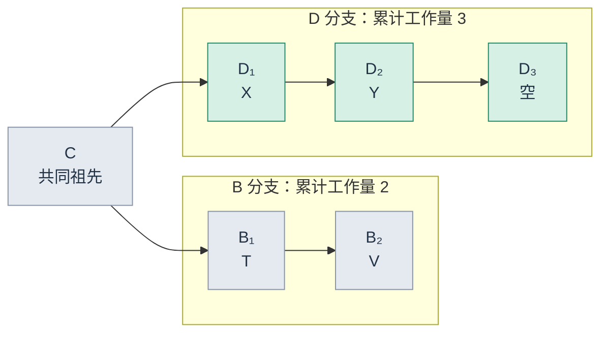

# 第 9 周作业

**区块链原理与技术（CS9301）· 第 9 周**

## 1. 算力与目标怎样影响出块和验证

>采用 8 位均匀哈希教学模型，哈希值为 0～255，不同输入的结果视为独立。协议规定当前目标 $T = 15$，满足 $h \le T$ 才通过 PoW 检查。矿工甲每秒尝试 8 次，其他矿工合计每秒尝试 24 次；忽略传播与分叉影响。
>
>以下候选接在同一已知有效父块之后，数据齐全。除表中指出的问题外，其余条件均符合规则；各候选头部中的 Merkle 根均与其交易列表一致。
>
>| 候选 | 头部填写的目标 | 哈希值 $h$ | 交易与奖励情况 |
>|:---:|:---:|:---:|---|
>| B | 15 | 12 | 全部符合规则 |
>| D | 31 | 20 | 全部符合规则 |
>| E | 15 | 3 | 含普通交易：输入总额 10，输出总额 11 |
>
>**回答下列问题：**

### 1.1 问题（1）
>**（1）** 计算单次成功概率、首次成功所需的期望尝试次数，以及甲独立搜索和全网搜索的平均等待时间。若甲已连续失败 16 次，下一次新输入的成功概率是多少？“平均 16 次成功”是否表示第 16 次必定成功？

单次成功概率：$p = \frac{15-0+1}{256} = \frac{16}{256} = 0.0625$ 
首次成功所需的期望尝试次数：$E[N] = \frac{1}{p} = \frac{1}{0.0625} = 16$ 
甲独立搜索的平均等待时间：$E[t] = \frac{E[N]}{8} = \frac{16}{8} = 2 \ \sec$ 
全网搜索的平均等待时间：$E[t] = \frac{E[N]}{8+24} = \frac{16}{32} = 0.5 \ \sec$ 

若甲已连续失败 16 次，下一次新输入的成功概率仍为 $p = \frac{16}{256} = 0.0625$。 
“平均 16 次成功”并不能说明第 16 次必定成功，因为这是基于概率的统计结果，而不是确定的事件。

### 1.2 问题（2）
>**（2）** 计算甲发现下一块的概率。若甲创建 100 个身份，但合计算力不变，该概率是否改变？结合女巫攻击，说明为什么公钥数量不能直接代表独立参与者数量。

概率不能改变，因为这里采用的是 PoW 模型，出块的概率只和算力有关，身份的数量改变不了算力，因此概率不会改变。

女巫攻击指的是：一个攻击者创建或者控制大量的虚假身份，企图利用这些身份来获取对系统更大的影响力。 
由于一个用户可以创建很多个公钥身份，因此公钥的数量不能代表独立参与者数量。否则攻击者就可以使用女巫攻击来控制系统的运行。

### 1.3 问题（3）
>**（3）** 分别判断 B、D、E 能否成为有效候选，指出未通过的检查。有同学认为“E 的哈希值最小，所以应优先接受”，这一判断是否正确？若两个有效区块的合法目标相同，实际分别尝试 1 次和 1000 次才成功，计入的工作量是否不同？

B 有效，D 无效， E 无效。 
对于D：由于当前协议规定 $T=15$，而 D 的头部中的目标 $T_0=31$，与协议不一致，因此无效 
对于E：由于普通交易输入总额为 10，输出总额为 11，输入值总额大于了输出值总额，不符合规则，因此无效。

>有同学认为“E 的哈希值最小，所以应优先接受”，这一判断是否正确？

这是不正确的，因为哈希值的大小与工作量无关。只要哈希值小于目标，就可以通过 PoW 检查，但并不能通过哈希值大小来判断谁该优先被接受。

如果两个有效区块的合法目标相同，实际分别尝试 1 次和 1000 次才成功，计入工作量是相同的。

### 1.4 问题（4）
>**（4）** 全网算力翻倍而目标暂时不变时，平均发现间隔如何变化？在本教学模型中，要恢复原平均间隔，应将目标调为多少？若矿工在找到合格头部后更换父块，能否沿用原哈希值作为新头部的 PoW 结果？说明需要重新核验什么。

平均发现间隔会减半。

如果要恢复原平均间隔，目标值也应该减半，应该从 $T = 15$ 调整到 $T = 7$。

矿工在找到合格头部后更换父块，不能沿用原哈希值作为新头部的 PoW 结果。 
需要重新核验 prevHash 是否指向新的父块，难度目标是否符合要求，重新计算区块头的哈希，检查新的哈希值是否满足新的目标值。

---

## 2. 分支切换怎样改变已采用的状态

>共同祖先 C 之后的状态为 $S_C = \{(u_0, A, 12), (v_0, G, 5)\}$。输出记为（标识，归属，金额），金额为教学单位。以下普通交易均获正确授权，忽略费用；只跟踪这些普通交易影响的 UTXO，不列 coinbase 输出。
>
>| 交易 | 消费的输出 | 创建的新输出 |
>|:---:|:---:|---|
>| T | $u_0$ | $(t_B, B, 8)$、$(t_A, A, 4)$ |
>| V | $t_B$ | $(v_E, E, 8)$ |
>| X | $u_0$ | $(x_M, M, 9)$、$(x_A, A, 3)$ |
>| Y | $x_M$ | $(y_F, F, 9)$ |
>
>B 分支为 $C \to B_1\text{(T)} \to B_2\text{(V)}$；D 分支为 $C \to D_1\text{(X)} \to D_2\text{(Y)} \to D_3\text{〔无普通交易〕}$。两条分支分别有效，各块难度相同、单块工作量均记为 1；无表外普通交易。
>
>节点 P 起初已验证并采用 $B_2$，累计工作相等时保留当前分支。之后依次发生：①收到 $D_1$、$D_2$ 完整数据并验证通过；②仅收到 $D_3$ 头部，头部规则检查通过，但缺少区块体；③取得 $D_3$ 区块体并完成全部验证。
>
>**回答下列问题：**

### 2.1 问题（1）
>**（1）** 写出 P 起初采用 $B_2$ 时的 UTXO 集合。T 与 V、T 与 X 分别是什么关系？P 当前状态中已没有 $u_0$，能否据此认定 $D_1$ 中的 X 无效？验证 X 应从哪个状态出发？

P 采用的是 $B_2$，$B_2$ 是由 $C \rightarrow B_1(T) \rightarrow B_2(V)$ 得到的。

最初 $S_C = \{(u_0, A, 12), (v_0, G, 5)\}$，  
执行 T : $S_{B_1} = \{(t_B, B, 8), (t_A, A, 4), (v_0, G, 5)\}$， 
执行 V : $S_{B_2} = \{(v_E, E, 8), (t_A, A, 4), (v_0, G, 5)\}$， 

T 和 V 是前后依赖关系，T 和 X 属于双花冲突关系。

不能据此断定 $D_1$ 中的 X 无效，交易有效性需要根据交易所在分支的前序状态进行验证，而不能直接使用节点当前采用的其他分支的 UTXO 状态进行判断。

### 2.2 问题（2）
>**（2）** 逐一写出事件①②③之后 P 采用的链头，并说明依据。为什么事件②中即使已能计算 D 分支头部的累计工作量，也不能立即切换当前账本状态？

|事件 | B 分支增加的工作量 | D 分支增加的工作量 | P 采用的链头 | 依据 |
|---|---|---|---|---|
|① 收到并验证 $D_1$、$D_2$ | 2 | 2 | $B_2$ | 两条分支累计工作量相等，保留当前分支 |
|② 收到 $D_3$ 头部，但缺少区块体 | 2 | 头部显示为 3 |$B_2$| $D$ 分支缺乏完整验证 |
|③ 取得 $D_3$ 区块体并完成验证 | 2 | 3 | $D_3$ | $D_3$ 分支工作量增加，超过 $B_2$，切换到 $D_3$ 分支。 |

在事件②中，即使能计算 D 分支头部的累计工作量，但是不能将其作为已经完整验证的有效主链，所以不能立即切换当前账本状态。

### 2.3 问题（3）
>**（3）** 写出重组时撤销旧分支、执行新分支的具体顺序，并依次列出撤销 V、回退至 C、执行 X、执行 Y 后的 UTXO 集合。指出始终未被消费的输出，并说明为什么不能直接在 $B_2$ 状态上执行 X。

P 原本采用的分支是：$C \rightarrow B_1(T) \rightarrow B_2(V)$ 
现在需要切换到：$C \rightarrow D_1(X) \rightarrow D_2(Y) \rightarrow D_3$

因此，重组时的具体顺序：撤销 $V$，撤销 $T$，执行 $X$，执行 $Y$

| 事件 | UTXO 集合 |
|---|---|
| 撤销 $V$ | $S_{B_1} = \{(t_B, B, 8), (t_A, A, 4), (v_0, G, 5)\}$|
| 回退至 $C$ | $S_C = \{(u_0, A, 12), (v_0, G, 5)\}$|
| 执行 $X$ | $S_{D_1} = \{(x_M, M, 9), (x_A, A, 3), (v_0, G, 5)\}$|
| 执行 $Y$ | $S_{D_2} = \{(y_F, F, 9), (x_A, A, 3), (v_0, G, 5)\}$|

始终没被消费的输出是 $(v_0, G, 5)$

说明为什么不能直接在 $B_2$ 状态上执行 X？ 
因为此时切换了主链分支，需要回退状态，重新执行。否则会导致前后依赖错误或者双花冲突。

### 2.4 问题（4）
>**（4）** 重组后，T 与 V 能否直接重新打包到 $D_3$ 之后？分别指出输入方面的问题。$B_1$、$B_2$ 退出当前主链，是否表示它们原来无效？T 在 $B_1$ 中的 Merkle 包含证明仍可验证，是否足以证明 T 当前已获主链确认？

重组后，T 和 V 都不能直接重新打包到 $D_3$ 之后。

对于 T： 
T 的输入为 $u_0$，但是在新的主链 D 分支中，$u_0$ 已经被 X 消费。 
因此：$u_0\notin S_{D_3}$。T 的输入已经不是当前主链状态中的未花费输出，因此不能在 $D_3$ 之后直接执行。

对于 V： 
V 的输入为 $t_B$，而 $t_B$ 是由 T 创建的输出。 
由于新的主链中没有执行 T，所以 $t_B$ 根本不存在于 D₃ 的 UTXO 集合中。 
因此：$t_B\notin S_{D_3}$。V 缺少有效的输入，同样不能在 $D_3$ 之后直接执行。

$B_1, B_2$ 退出当前主链，并不表示它们原来无效。它们通过了完整的验证，符合协议规定，因此依然是有效的，只是当前分支 D 具有更大的累计工作量，因此原来分支 B 下的区块暂时退出主链。

不能。 
因为 $B_1$ 不再属于当前主链。 
因此，即使 T 在 $B_1$ 中的 Merkle 包含证明仍然能够成功验证，也只能说明 T 被包含在 $B_1$ 中，不能说明 T 当前已获得主链确认。

---

## 3. 可见确认数怎样区别于实际追赶差距

>商户收到付款 T，T 位于 C 之后的首个公开区块 $B_1$。攻击者从 C 开始秘密挖另一条分支，首块包含消费同一输入的冲突付款 X；输入由攻击者控制，T、X 分别获正确授权。两条分支难度相同，且分别满足全部规则。
>
>当前公开分支为 $C \to B_1\text{〔T〕} \to B_2 \to B_3 \to B_4$。比较以下三种互相独立的情形；隐藏分支均尚未广播，商户只看到上述公开分支。
>
>| 情形 | C 之后的公开块数 | C 之后的隐藏块数 |
>|:---:|:---:|:---:|
>| 甲 | 4 | 0 |
>| 乙 | 4 | 2 |
>| 丙 | 4 | 3 |
>
>采用固定算力与难度、独立出块、无传播损失的模型。攻击方占比 $q = 0.25$，诚实方 $p = 0.75$。实际差距 $z$ 为公开块数减去隐藏块数；每次出块使 $z$ 增加或减少 1。首次到达 $z = 0$ 即记为“追平”并停止。节点在累计工作相等时保留当前分支。
>
>**回答下列问题：**

### 3.1 问题（1）
>**（1）** 商户看到 T 有几次确认？分别计算甲、乙、丙的实际差距 $z$。为什么确认数相同，攻击者需要追赶的差距却可以不同？若不知道隐藏分支进度，能否直接把确认数代入已知差距的追平公式？

商户看到 T 有 **4** 次确认

甲的实际差距：$z_{甲} = 4 - 0 = 4$  
乙的实际差距：$z_{乙} = 4 - 2 = 2$  
丙的实际差距：$z_{丙} = 4 - 3 = 1$ 

商户看到的确认数只能反映公开分支的情况，不能反映攻击者秘密分支的进度。因此确认数相同不意味着攻击者需要追赶的差距相同。

若不知道隐藏分支进度，不能直接把确认数代入已知差距的追平公式。 
因为已知差距的追平公式需要使用实际差距 $z$，而不是直接使用公开分支的确认数。

### 3.2 问题（2）
>**（2）** 仅考虑情形乙，分别计算接下来两次出块内、四次出块内首次追平的概率。用“攻”“诚”表示出块方，列出成功路径及差距变化；路径在首次追平时结束，不能将已成功路径的后续延伸重复计数。

考虑情形乙：$z_0 = 2$

考虑两次出块内首次追平的情况： 
成功路径：$(初始, z=2) \rightarrow (攻, z=1) \rightarrow (攻, z=0)$ 
此时需要两次均为攻击者出块，则概率为：$P_2 = q^2 = 0.25^2 = 0.0625$

### 3.3 问题（3）
>**（3）** 仍在情形乙，计算允许无限次出块机会时的最终追平概率。解释它与第（2）问结果的差别。该数值能否直接称为“商户看到 4 次确认后的双花成功概率”？说明事件定义和已知信息方面的限制。

### 3.4 问题（4）
>**（4）** 攻击者追平后立即公布完整分支，是否必然使商户节点撤销 T？若独立将 $q$ 改为 $0.5$，最终追平概率为 1，是否意味着接下来 10 次出块内必定追平？即使攻击者掌握多数算力，能否使伪造签名或超额奖励的区块被守规全节点接受？分别说明理由。

---

## 4. 更快出块和加入矿池分别改变什么

某矿池比较两种出块方案。传播窗口 $\Delta$ 指一个新区块产生后，其他矿工尚未收到它的时间；$\lambda$ 为其他矿工合计的平均出块速率。假设窗口内出块数近似服从泊松分布，则至少再出 1 块的概率为：

$$
P = 1 - e^{-\lambda\Delta}
$$

| 方案 | 其他矿工合计的平均出块间隔 | 传播窗口 $\Delta$ |
|:---:|:---:|:---:|
| 甲 | 100 秒 | 2 秒 |
| 乙 | 10 秒 | 2 秒 |

另作收益计算：四名矿工各占全网算力的 2%，组成矿池后按算力比例分配每次收入。单块收益为 20 个计价单位，忽略费用与矿池手续费，假设出块均被采用。以每产生一个全网区块为一次观察。

矿池份额另用 8 位哈希模型说明：全网目标 $T_{\mathrm{net}} = 7$，矿池目标 $T_{\mathrm{pool}} = 63$。某矿工对三个不同的有效任务输入分别得到哈希值 5、40、90；满足矿池目标可记份额，满足全网目标才达到全网 PoW 要求。

**回答下列问题：**

**（1）** 分别计算甲、乙方案在传播窗口内至少再出 1 块的概率，百分数保留两位小数。为何出块更频繁可能增加分叉？落在竞争分支上的诚实工作，能否直接相加为当前主链增加的工作量？

**（2）** 对哈希值 5、40、90，分别判断能否记为矿池份额、能否满足全网 PoW。矿池能否把目标 63 当作全网接受区块的目标？即使某提交满足全网 PoW，全节点还需进行哪些内容检查？

**（3）** 计算一名矿工独立挖矿和加入上述矿池时，获得收益的概率、获得收益时的金额，以及每次观察的期望收益。矿池为何能降低个人收入波动？若交易和父块均由组织者选择，会带来什么决策集中问题？

**（4）** 某交易已被矿工收到，在当前分支下持续有效，却连续多个区块都未被选入；主链仍不断增长。这是否说明出块已停止？指出两类可能的等待原因，并说明为什么“平均出块间隔缩短为十分之一”不能保证该交易的稳定确认时间也缩短为十分之一。
