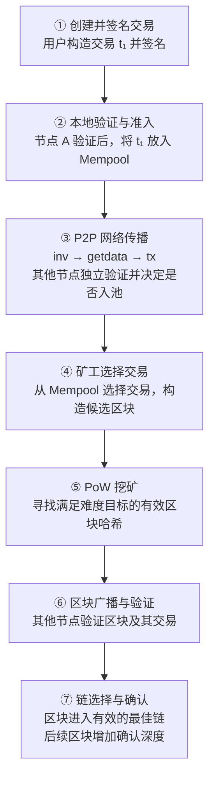
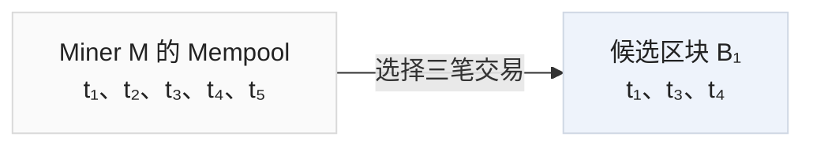
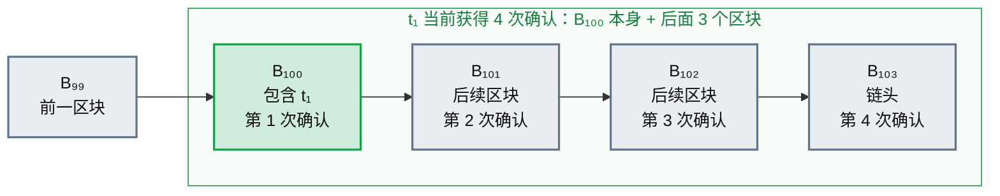
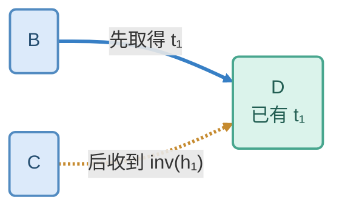

#  intro

| 章节 | PPT 页码 | 核心内容 |
| --- | --- | --- |
| 第 1 节：节点发现、连接与交易传播	| Pages 1–50 | P2P 网络、节点发现、握手、交易 Gossip、Mempool |
| 第 2 节：区块同步	| Pages 51–93 | Headers-first、区块下载、乱序到达、顺序验证 |
| 第 3 节：节点处理	| Pages 94–128 | 交易接纳策略、请求超时、换源重试、迟到回复 |

建议进一步拆成以下七个学习阶段：
01 节点为什么需要 P2P 网络？ Pages 1–17

02 完整模拟交易传播与节点状态变化 Pages 18–50

03 Headers-first 区块同步的设计动机 Pages 51–62

04 并行下载、乱序到达与顺序验证 Pages 63–93

05 共识有效性与本地交易池策略 Pages 94–106

06 超时、换源重试与迟到消息 Pages 107–123

07 综合推演与知识总结 Pages 124–128

本周重点解决 Networking（网络通信）：在达成共识之前，节点怎样获得参与判断所必需的数据？

# 1. 节点发现 和 交易传播 基础

**问题 A：交易能不能传到其他节点？**

这是网络通信问题。A 收到交易，并不代表 B、C 或网络中的其他节点已经收到。

**问题 B：其他节点收到交易后是否应该接受？**

这是交易验证问题。即使交易成功传播，也不意味着它一定有效。

因此，区块链中的交易处理至少涉及三个不同的动作：
$$
\boxed{\text{传播}\rightarrow\text{验证}\rightarrow\text{接纳}}
$$

而且，交易被接纳到交易池并不等于交易已经确认。

**交易池（Mempool）**

| 交易池（Mempool） | 已确认记录 |
| --- | --- |
| 暂存节点已接纳的未确认交易 | 记录已经按区块链规则处理的历史 |
| 不同节点可能不同 | 由节点验证的区块链历史决定 |
| 可以加入、移除或替换交易 | 不能仅凭新交易到达而改变 |

## p2p 网络

P2P 网络采用另一种方法：

每个节点只维护有限数量的邻居连接，通过邻居的进一步传播，让交易到达更远的节点。

这种交易传播方式通常称为 Gossip（流言传播）

## 节点发现，建立连接，数据验证

### peer discovery 节点发现

没有中心化的注册表

三种候选地址来源：
- 本地保存的历史节点地址。
- DNS Seeds（DNS 种子）提供的节点地址。
- 已连接邻居分享的节点地址。

候选地址通常包含 IP 和端口，例如 PPT 使用的：`203.0.113.3:8333`  
但知道地址，只表示知道一个可以尝试联系的位置。 
它并不能证明该节点可达，也不能证明对方可信。

### connection establishment 建立连接

双方交换 `version` 和 `verack` 消息

- `version` 消息主要声明协议版本和服务能力。
- `verack` 用来确认已经收到对方的版本消息。

### validation 独立验证

这里存在一个重要的安全原则：
$$
\text{Connection Established}\not\Rightarrow\text{Data Trusted}
$$

握手完成，只能说明两个节点已经建立了通信关系。

不代表：
- 对方提供的交易一定有效。
- 对方发送的区块一定正确。
- 对方具有某种经过认证的现实身份。

**P2P 网络提供通信能力，密码学及区块链规则提供数据验证能力**
- 通过数字签名解决

## 传播交易流程

### 解释 notation

- $h_1$: $h_1$ 是交易 $t_1$ 的哈希值（Hash），用于唯一标识这笔交易
- `inv(h_1)`: 通告交易, 发送交易 $h_1$ 的消息
    - 为什么不能只传播 $h_1$？: 因为哈希值仅仅是交易的标识，不包含足以执行和验证交易的完整信息。
    - 为什么先发送 inv，而不直接发送 tx？: 主要动机是避免不必要的重复数据传输。
- `getdata(h_1)`: 按需请求  
节点 C 检查自己是否已经拥有交易 $h_1$。
    - 如果已经拥有，不需要请求。
    - 如果没有，就向 A 发送 getdata(h₁)。
- tx(t₁)：传输完整交易 
A 收到请求后，发送完整交易数据 $t_1$。 
C 收到后可以：
    - 计算交易哈希，检查其标识是否与 $h_1$ 一致。
    - 验证交易签名及其他有效性规则。
    - 在验证通过后，将交易保存到本地交易池（Mempool），并视情况继续向其他节点传播。

**C 收到 tx 后，可以立即转发吗？**
不能直接得出这个结论。

PPT Page 17 要求 C 先完成：
1. 核对交易标识、数字签名和授权。
2. 结合自己的本地记录检查交易。
3. 检查本地交易接纳条件。
4. 通过后暂存到交易池，再向其他邻居通告。

因此：
$$
\text{收到 tx}\not\Rightarrow\text{已经入池}
$$

$$
\text{已经入池}\not\Rightarrow\text{已经确认}
$$

## 演示完整流程

### 节点发现

### 建立连接和协议握手

- 传输连接建立
- 应用层握手

### 交易正文的按需获取

|时刻 | C 已持有的数据 | C 的交易池 |
| --- | --- | --- |
|握手完成	 | 无 $h_1$，无 $t_1$ | 空 |
|收到 inv(h1) | 只有 $h_1$ | 空 |
|发送 getdata(h1) | 只有 $h_1$，等待正文 | 空 |
|收到 tx(t1) | 完整交易 $t_1$ | 仍为空 |
|后续检查通过并接纳 | 完整交易 $t_1$ | $\{t_1\}$ |

C 已经收到了完整交易，但交易池仍为空。

原因是 C 尚未完成独立验证和接纳操作。

因此需要区分：
$$
\text{Received Transactions}
$$

与
$$
\text{Accepted Transactions}
$$

### 交易验证 和 入池

C 对交易 $t_1$ 执行了一系列检查。

包括：
1. 交易标识是否匹配。
2. 数字签名和授权是否有效。
3. 交易是否符合本地记录对应的规则。
4. 交易是否满足本地接纳条件。

#### 交易纳入本地池 和 交易得到区块链共识确认：

从交易进入本地交易池（Mempool），到最终获得区块链确认，中间还需要经历矿工选择交易、构造候选区块、PoW 挖矿、区块广播、全网独立验证和链选择等步骤。

首先要区分两个概念：
- 交易被接受（Accepted）：某个节点认为交易有效且符合自己的交易池策略，愿意暂时保存并传播它。
- 交易被确认（Confirmed）：交易已经被包含在主链上的有效区块中。随着后续区块不断增加，这笔交易的确认深度也随之增加。

我们以 Bitcoin 的 PoW 共识为例，从交易产生开始理解整个流程。

##### 1. 交易从产生到确认的完整生命周期

##### 2. 进入 Mempool 后，究竟发生了什么？

**第一步：矿工从 Mempool 中选择交易**

假设节点 A、B、C 都已经收到了交易 $t_1$。

此时：
- A、B、C 的 Mempool 中可能都有 $t_1$。
- $t_1$ 仍然是一笔未确认交易（Unconfirmed Transaction）。
- 矿工 M 也可能已经收到 $t_1$。
矿工需要从自己的 Mempool 中选择交易，构造一个候选区块（Candidate Block）。

为什么还要选择？

因为区块容量有限，矿工无法保证把所有待确认交易都装入下一个区块。

矿工通常会优先考虑能带来较高手续费收益的交易，尤其是手续费率（Fee Rate），同时也要考虑交易之间的依赖关系。

例如：

示意：矿工 M 选择了三笔交易，$t_2$ 和 $t_5$ 仍留在交易池等待后续机会。

此时矿工虽然选择了 $t_1$，但 $t_1$ 仍然没有获得区块链确认。

**第二步：矿工构造区块并执行 PoW**

矿工将选中的交易组成候选区块，并构造区块头。

你之前学过 PoW 的核心条件：
$$
H(\text{BlockHeader}) < \text{Target}
$$

矿工通过不断调整区块头相关数据，寻找满足难度目标的哈希值。

这里最重要的是：构造候选区块不等于成功出块。

多个矿工可以同时尝试创建下一个区块，只有找到有效 PoW 的候选区块，才有资格被网络接受。

**第三步：矿工广播新产生的区块**

假设矿工 M 找到了有效的 PoW。

它向其他节点广播新区块 $B_1$。

其他节点收到区块后，不能因为 M 声称挖矿成功就直接接受，而是要独立验证：
1. 区块的 PoW 是否满足难度要求？
2. 区块结构和前一区块哈希引用是否正确？
3. 区块中所有交易是否符合共识规则？
4. 是否存在双重花费？
5. 区块奖励、区块权重等是否符合规则？

只有验证通过，节点才会接受该有效区块。[来源](https://help.blockstream.com/education/nodes/introduction-and-role/what-is-the-role-of-a-node-in-mining?utm_source=chatgpt.com)

这一点与之前的 Mempool 准入不同：

Mempool 接受的是一笔待确认交易；区块验证决定这笔交易能否成为正式区块链历史的一部分。

**第四步：节点更新区块链状态**

假设有效区块 $B_1$ 被节点接收，且成为该节点当前最佳有效链的区块。

该节点就会按照 $B_1$ 内的交易顺序更新 UTXO 集合。

例如：

交易 $t_1$ 花费 Alice 的某个 UTXO，并创建属于 Bob 的新 UTXO。

当 $B_1$ 被连接到当前最佳链时：
- Alice 被花费的 UTXO 从集合中移除。
- Bob 收到的新 UTXO 被加入集合。
- $t_1$ 从节点的 Mempool 中移除。

此时，$t_1$ 获得 **1 次确认（1 Confirmation）**。

但注意，这不代表所有节点必须先通过投票批准这个区块。Bitcoin 的节点各自按照统一的共识规则验证区块，并通过累计工作量最多的有效链规则处理竞争分叉

##### 3. 为什么一笔交易进入区块后，还要等待更多确认？

这里涉及你之前学习过的 PoW 分叉问题。

假设交易 $t_1$ 已经包含在区块 $B_{100}$ 中。

确认次数的计算公式为：
$$
\text{Confirmations}=H_{\text{tip}}-H_{\text{tx}}+1
$$

其中 $H_{\text{tip}}$ 是当前链头高度，$H_{\text{tx}}$ 是包含交易的区块高度。

为什么要等待后续区块？

因为可能存在两个矿工几乎同时找到有效区块，导致网络出现临时分叉。

假设：
- 矿工 M 生成 $B_{100}$，包含交易 $t_1$。
- 矿工 N 同时生成 $B'_{100}$，不包含 $t_1$。
两个区块可能都有效，但它们属于不同的分支。

如果后续 $B'_{100}$ 所在分支成为累计工作量更多的有效链，节点就可能发生 Chain Reorganization（链重组）。

这意味着 $t_1$ 原来的确认可能被撤销。如果它仍然有效且符合本地策略，可以重新进入 Mempool，等待后续确认。

所以 Bitcoin 的确认具有概率最终性（Probabilistic Finality）：
- 1 次确认：交易已进入当前最佳链。
- 多次确认：交易被链重组撤销的风险通常进一步降低。
- 不存在一个固定确认次数，可以在协议层面保证绝对不可逆

### 向其他节点传播

## local view

同一时刻，不同节点观察到的网络状态可以不同。

**区块链节点的交易池不要求时刻保持一致。**

## deduplication

根据 Page 44 的案例：
1. D 已经从 B 取得并暂存 $t_1$。
2. C 随后又向 D 通告相同交易标识 $h_1$。

D 此时应该怎么处理？ 
答案是：无需重新请求相同交易正文。

因为：
$$
h_1\in KnownTransactions_D
$$

且 D 已经保有对应的完整交易。

这就是去重机制的作用。

它解决两个问题：
- 防止重复下载同一份数据，浪费带宽。
- 避免在本地交易池中重复保存、处理相同交易。

不过仍应区分两个状态：
|本地状态|后续动作|
| --- | --- |
|只知道 $h_1$，没有正文|若需要该交易，则请求正文
|已有完整 $t_1$|不因重复通告而重新请求

所以，收到过一个交易标识，并不等于一定不需要再次请求正文。

# 2. 区块同步

## 为什么需要区块同步

前面讨论的是一笔新交易如何传播到其他节点。

现在考虑另一种情况：

**一个区块链节点离线了一段时间，重新上线后，如何补齐离线期间产生的区块？**

场景：

节点 N 目前已经验证到 B100，而 P、Q、R 都有 B101、B102、B103。

N 需要完成两个任务：
1. 发现缺口：确定 B100 后面有哪些区块，以及它们怎样连接。
2. 补齐并验证历史：获取缺失的完整区块，按区块之间的依赖关系完成验证。

## 网络架构基础

**比特币 P2P 通信使用 TCP；多个邻居连接之间，区块仍可能乱序到达。**

这里存在一个容易混淆的问题： 
**TCP 保证有序传输，为什么区块还会乱序到达？** 
因为 TCP 只保证同一条连接内的字节流有序，并不保证多个不同 TCP 连接上的应用层数据按统一顺序到达。 
例如：
- N 向 P 请求 B101。
- N 向 Q 请求 B102。
- Q 的响应比 P 更快。

即使两条 TCP 连接各自都正常工作，N 仍然可能先收到 B102。

## block header 和 block body

### 区块的基本组成

### 为什么先下载 block header

假设 N 当前已验证到 B100。

最直接的方案似乎是：

“让 P 把 B101、B102、B103 全部发给我。”

但是，N 还需要先弄清楚哪些区块是候选后续区块，以及它们之间是否满足预期的前后连接关系。

因此，PPT 采用 **Headers-first Synchronization（头部优先同步）。**

区块同步流程：

$$
\boxed{
\text{先同步区块头}
\rightarrow
\text{确定候选区块及缺失正文}
\rightarrow
\text{下载完整区块}
}
$$

- pros：
    - 在获取完整交易数据之前，先判断候选区块的前后连接关系和头部规则。
    - 知道自己具体缺少哪些区块。
    - 可以根据区块标识向不同邻居请求完整区块。
    - 不需要为了发现后续区块而立即下载所有交易正文。
- 需要注意的限制:
    - 区块头检查通过，不代表完整区块已经验证通过。

### 为什么完整验证还需要依赖前序状态

这一页实际上引出了后续乱序处理的核心原因。

假设：
$$
B_{100}\rightarrow B_{101}\rightarrow B_{102}
$$

节点 N 已经验证 B100，对应的本地状态记为 $S_{100}$。

要验证并应用 B101 中的交易，就需要在 $S_{100}$ 的基础上执行对应的状态转移：
$$
S_{101}=Apply(S_{100},B_{101})
$$

随后验证并应用 B102：
$$
S_{102}=Apply(S_{101},B_{102})
$$

这里 Apply 表示：检查区块中的交易是否符合前序状态下的规则，并在有效时应用这些交易。

因此，即使 N 已经拿到了完整 B102，也不一定可以直接完成 B102 的验证。

因为：$S_{101}$ 可能尚未计算出来。

完整验证工作中，有两类检查：
- 第一类：不依赖前序状态的检查。 
    例如：
    - 区块数据能否正常解析。
    - 区块正文是否与区块头中的交易内容摘要一致。
- 第二类：需要前序状态的检查。 
    例如：
    - 前序区块是否已经验证。
    - 当前交易在对应的前序状态下是否符合规则。
    - 是否能够应用交易并推进本地状态。

### 怎么找到缺失的区块

#### 用 区块哈希， 而不是 高度 作为标识

#### `getheaders` 和 `headers`

N 已经验证到 B100，因此知道：$h_{100}$

现在它向 P 请求后续区块头。

两种消息的作用：
| 消息 | 方向 | 作用 |
| --- | --- | --- |
|getheaders	| N → P	|请求已知位置之后的区块头|
|headers | P → N | 返回一段候选区块头序列|

注意：headers 返回的是区块头，不包括完整交易正文。

#### 形成候选区块序列

N 收到头部之后，可以检查：
$$
h_{100}\rightarrow h_{101}\rightarrow h_{102}\rightarrow h_{103}
$$

这里箭头表示链从前一个区块延伸到后一个区块。

N 可以记录缺失正文的标识：
$$
MissingBodies=\{h_{101},h_{102},h_{103}\}
$$

然后根据这些标识进一步下载完整区块。

这里要区分：
- 已获得候选头部。
- 已获得完整区块。
- 已完成区块验证。
即使 N 已经检查完所有候选头部，本地完整区块的验证进度仍可能停留在 B100。

### 下载完整区块

#### `getdata` 和 block

#### 允许并行下载

**下载可以并行，但依赖前序状态的完整验证不能随意跳跃。**

### 为什么不能只用一个“最新高度”？

这揭示了三个不同的概念：
$$
\boxed{
\begin{aligned}
&\text{Header Progress}\\
&\text{Download Progress}\\
&\text{Validation Progress}
\end{aligned}
}
$$

它们可以各不相同。

也就是：**区块的发现、下载和验证是三个不同的过程，可以具有不同的进度。**

这与前一部分区分“收到交易、交易入池、交易确认”的思想是一致的：不能把数据已经到达和数据已经被验证、应用混为一谈。

## 并行下载、乱序到达与顺序验证 （演示）

### 发现缺口并并行请求区块

### 乱序到达 （B102 先到，为什么不能立即验证？）

### 顺序验证（前序区块到达后，如何推进验证？）

### 待处理区 和 异常数据

#### pending blocks

假设： B102 已经到达，但是：B101 仍未取得。 
N 需要有一个地方保存 B102，等待依赖满足。 
PPT Page 88 将这个位置称为**待处理区**。

#### 如果 B101 的正文不合格怎么办

考虑另一种情况：
- N 已经缓存 B102。
- N 的验证进度仍为 B100。
- P 返回了 B101。
- 但是 B101 的正文与其区块头中的交易摘要不匹配。
这时候不能继续验证 B101。

N 应当：
1. 拒绝这份不合格的 B101 正文。
2. 不将这份正文加入有效的待处理数据。
3. 继续保留此前取得的 B102。
4. 从其他能够提供数据的邻居请求 $h_{101}$ 对应的正确正文。
特别注意：

拒绝来自 P 的一份不合格回复，不等于证明 $h_{101}$ 所标识的正确区块无效。

这是在区分“收到的数据有问题”和“目标区块本身有问题”。

### 乱序到达 综合推演

# 3. 节点处理

## 3.1 交易接纳策略

前面学习了交易传播与区块同步，这部分要回答一个新问题：

为什么一笔交易通过了规则检查，节点却仍然可能不把它加入自己的 Mempool（交易池）？（同一笔交易通过规则检查，为什么 P 接纳，Q 仍可能暂不接纳？）

我们将重点区分两个概念：
- Consensus Validity（共识有效性）：交易是否符合区块链共识规则。
- Mempool Admission Policy（交易池接纳策略）：节点是否愿意在本地暂存这笔交易。

### 3.1.1 为什么交易有效却可能不入池？

#### 3.1.1.1 设计动机：节点为什么需要接纳策略？

之前我们学习过，节点收到完整交易 $t_2$ 后，需要检查交易签名、授权以及本地记录等条件。

但如果一笔交易通过了这些检查，是否意味着节点必须把它存入自己的交易池？

不一定。

原因在于：区块链节点的内存、存储空间和网络带宽都是有限的。

如果一个开放网络允许任何人不断向节点发送交易，而节点又必须无条件保存所有通过规则检查的交易，就可能耗尽本地资源。

因此，节点除了判断交易是否符合规则，还需要决定：

**是否值得占用自己的有限资源来暂存和转发这笔交易？**

这就是 Mempool Admission Policy 的作用。

#### 3.1.1.2 有效性规则 和 本地策略

| 比较维度 | 有效性规则 | 本地接纳策略 |
| --- | --- | --- |
|关注问题| 交易是否符合相关规则 |节点是否愿意暂存交易|
|典型检查|授权、当前记录是否允许支付|交易池容量、暂存和转发条件|
|规则未满足|不能作为有效交易接纳|本地可以暂不接纳|
|是否决定共识有效性	|是，共识规则决定有效性	|否，不能修改共识规则|

**符合规则**：
$$
Valid(t,S)
$$
表示交易 $t$ 在相关状态 $S$ 下是否符合规则。

**接纳交易**
$$
Admit(t,M,R)
$$
表示节点根据当前交易池 $M$ 和资源条件 $R$，是否接纳交易。

### 3.1.2 同一笔交易，为什么 P 接纳、Q 拒绝？

这里容 mempool 的容量为限制用来说明这个问题

### 3.1.3 如何判断一笔交易为什么没有入池？

| 情形 | 实际原因 | 正确结论 |
| --- | --- | --- |
|尚未取得正文|Q 只有交易标识，或尚未收到交易|还不能检查|
|规则检查失败|交易内容不符合所需规则|不能作为有效交易接纳|
|本地策略未满足	| 例如池满且不允许置换 | 本地暂不接纳|

这三种情况在最终观察上完全可能相同：
$$
t_2\notin Mempool_Q
$$

但它们背后的原因不同。

因此，节点实现中需要区分处理阶段和拒绝原因

**节点未入池，不能据此判断交易无效**

### 3.1.4 交易接纳与区块获取是两种不同任务

### 3.1.5 区块请求为什么需要超时机制

#### 3.1.5.1 设计动机

假设 N 缺少 B101，而 P、Q 都声称持有 B101。

N 首先向 P 请求：
$$
N\xrightarrow{\texttt{getdata}(h_{101})}P
$$

但是 P 迟迟没有返回。

现在有一个问题：

**N 是否应该无限等待 P？**

显然不合理。

因为 P 可能处理缓慢、网络可能存在延迟，或者连接已经出现故障。

所以需要设置 Request Timeout（请求超时）。

#### 3.1.5.2 超时策略

#### 3.1.5.3 记录请求状态

可以把请求记录抽象为：
$$
R=(target,status,source,attempts,deadline)
$$

各字段含义如下：
| 字段 | 含义 |
| --- | --- |
|target|请求目标，例如 $h_{101}$| |
|status|正在等待还是已经完成|
|source|当前请求来源 P 或 Q|
|attempts|已经尝试的次数|
|deadline|本次等待的截止时间|

请求第一次发送后：
$$
R=(h_{101},Waiting,P,1,3)
$$

超时改向 Q 请求后：
$$
R=(h_{101},Waiting,Q,2,6)
$$

#### 3.1.5.4 超时意味着对方是恶意节点吗？

不能。

到第 3 秒时，N 实际观察到的事实只是：

在规定期限内，没有取得目标区块的合格正文。

可能存在多种原因：
- 请求仍在网络中传输。
- P 的处理速度比较慢。
- 响应已经发出，但还没有到达 N。
- P 离线或连接发生故障。
单凭超时，N 无法判断到底发生了哪一种情况。

### 3.1.6 为什么 TCP 已经有重传，P2P 还需要超时恢复？

这是一个非常重要的网络协议分层问题。

TCP 已经提供可靠、有序的字节流，并具有必要的重传机制。

那为什么区块链 P2P 应用层还需要维护自己的请求超时？

原因在于：TCP 与 P2P 应用层关心的是不同的问题。

| TCP 负责 | 区块链 P2P 应用层负责 |
| --- | --- |
|单条连接内字节流的可靠有序传输	|请求具体的区块 $h_{101}$|
|必要时重传丢失的传输数据	|判断目标区块是否已经取得|
|处理传输连接相关问题	|等待、超时、换源请求|
|不理解区块有效性	|检查区块内容和完成状态|

### 3.1.7 summary

这一阶段需要掌握三个核心区别。

| 概念区分 | 核心结论 |
| --- | --- |
| 交易有效性 vs 本地接纳	|交易通过规则检查，也可能因本地策略不满足而不入池 |
| 请求超时 vs 节点恶意	|超时可以触发重试，但不能证明对方恶意 |
| TCP 可靠传输 vs 区块请求完成 | TCP 不负责判断应用层是否取得目标区块 |

从系统实现角度看，本阶段出现了两个重要的本地状态管理任务：

交易池管理：
$$
Admit(t,M,R)
$$

根据交易检查结果、当前交易池和资源条件，决定是否接纳交易。

区块请求管理：
$$
RequestState(h)
$$

根据请求目标、来源、等待期限和完成情况，决定是否继续等待或换源。

它们共同体现了区块链节点的一种设计原则：

节点既需要独立验证数据，也需要在有限资源和不可靠的网络环境中管理自己的处理状态。

## 3.2 请求超时、换源重试与迟到回复（演示）

这一部分进一步研究区块链 P2P 网络中的 Request Recovery（请求恢复）。

核心问题是：

节点 N 已经因为超时从 P 改向 Q 请求某个区块，但 P 原来的回复随后又到达。N 应该如何处理？

### 3.2.1 请求超时与换源重试

### 3.2.2 完整模拟一次超时恢复

### 3.2.3 请求恢复状态机

### 3.2.4 旧来源的回复还能使用吗？

前面的案例中，Q 比 P 先返回了数据。

但如果顺序反过来呢？

假设：
- $t=0$：N 向 P 请求。
- $t=3$：P 超时，N 改向 Q 请求。
- $t=3.5$：P 的旧回复到达。
- $t=4$：Q 的回复到达。
问题是：

虽然当前来源已经变成 Q，N 能否接受 P 的回复？

答案是：可以，只要当前下载任务尚未完成，并且 P 返回的内容匹配目标、通过必要检查。

为什么？

因为这个下载任务真正关心的是：
$$
\boxed{\text{是否取得 }h_{101}\text{ 对应的合格正文}}
$$

### 3.2.5 两种迟到回复的推演

### 3.2.6 总结

1. 请求是有状态的
2. 消息到达顺序不能决定处理正确性
3. 下载完成状态与区块验证状态相互独立

## 3.3 资源限制，综合判断

### 3.3.1 节点需要资源限制

|资源管理机制| 作用 |对应的前面知识|
| --- | --- | --- |
|本地接纳策略 |决定暂存和转发哪些数据|Mempool Admission|
|等待期限 |决定请求等待多久以及何时恢复|Request Timeout| |
|尝试上限 |防止无限重复请求|Retry Limit|

